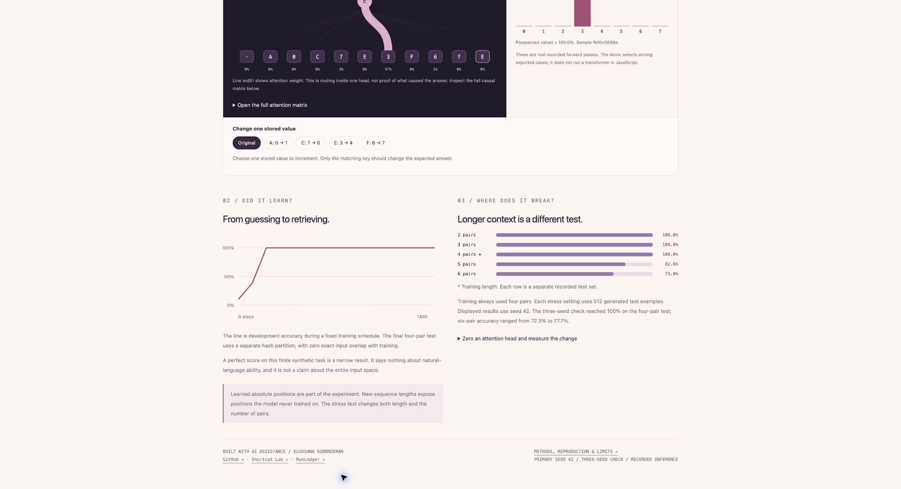

# Recall Lab

**A tiny transformer, opened up.** Train a model from random weights, follow its attention, and change the information it has to retrieve.

[Open the explorer](https://eluxsana.github.io/recall-lab/) · [Methods & limits](METHODS.md) · [Recorded results](results.json) · [Three-seed check](seed-study.json)



I wanted a model small enough to take apart. The task is deliberately simple: show four key/value pairs, ask for one key, predict its value. There is no natural language, pretrained model, external API, or employer data.

```text
A → 0    C → 7    E → 3    F → 6
                         ask E → 3
```

The interesting part comes after training. Which tokens does each head attend to? Does changing the matching value change the prediction? What happens if we remove a head's output or give the model a longer sequence?

## What you can do

- Switch between **two layers and four heads** and trace actual attention weights.
- Inspect the full causal attention matrix, including masked future positions.
- Choose eight recorded test examples and **32 input interventions**. These are genuine forward passes, not illustrative animations or live browser inference.
- Compare single-head and whole-layer attention-output ablations on all 1,024 primary test examples.
- Inspect the training curve and the failure at longer input lengths.
- Download the small **safetensors checkpoints** and independently recompute the reports.

## Measured, with a narrow scope

The model has **69,832 parameters**, width 64, two pre-norm transformer blocks, four attention heads per block, learned absolute positions, and a final-token classifier. It trains on CPU from random initialization.

| Test | Primary seed 42 |
|---|---:|
| Four-pair test, 1,024 examples | 1,024 correct |
| Copy-last-value baseline, same test | 34.0% |
| Five-pair stress test, 512 examples | 82.6% |
| Six-pair stress test, 512 examples | 75.0% |
| Zero all attention-head outputs in layer 1 | 37.0% |
| Zero all attention-head outputs in layer 2 | 27.2% |

Seeds 42, 43, and 44 all reached 100% on the same four-pair test. Six-pair accuracy ranged from **72.3% to 77.7%**. This is a three-run sensitivity check with fixed data, not a broad robustness result or a tight uncertainty estimate. The explorer displays seed 42 throughout.

Training, development, and test examples occupy disjoint SHA-256 hash partitions of the generated input space. No exact test input occurs in training. The test is synthetic and finite; a perfect score is not proof of general retrieval ability. The longer-length test changes both context length and number of stored pairs.

**Attention is routing, not a causal explanation.** The head-output interventions are separate measurements. An unchanged accuracy score after deleting a head does not establish that the head is irrelevant; loss can still rise and other heads can compensate.

## Reproduce

Python 3.10+ and PyTorch. The recorded run used Python 3.12.14, PyTorch 2.14.0 and safetensors 0.8.0, CPU with two threads.

```sh
git clone https://github.com/eluxsana/recall-lab.git
cd recall-lab
python3 -m venv .venv
source .venv/bin/activate  # macOS / Linux
python3 -m pip install -r requirements.txt
python3 -m unittest -v
python3 verify.py
python3 train.py --seed 42 --steps 1400 --out my-run
```

`verify.py` loads the safe tensor checkpoint and recomputes test metrics, attention ablations, length stress, and all 40 recorded forward passes. `train.py` exports fresh weights, raw measurements, and a self-contained explorer. It refuses to overwrite an output directory. Training took about nine seconds on the recorded machine; other hardware can differ. No GPU is required.

To reproduce the sensitivity check, repeat with `--seed 43` and `--seed 44`, choosing new output directories. Training time and floating-point results can vary across environments. Bitwise cross-platform reproduction is not promised.

## Files worth opening

- `model.py`: task generator, hash split, explicit Q/K/V attention, causal mask, residual blocks.
- `train.py`: fixed training schedule, measurements, head interventions and export.
- `test_model.py`: causal-prefix invariance, mask/normalization, split isolation, intervention semantics and checkpoint round trip.
- `verify.py`: evidence recomputation, including source/checkpoint hashes.
- `explorer.html`: report template; `index.html` is the generated offline report.
- `seed-study.json`: all three runs' summaries, dataset hashes and checkpoint hashes.

## Development and context

Built with AI assistance. All code, weights, and generated data in this repository are MIT licensed. This is an educational model experiment, not a new architecture or a claimed discovery of an induction circuit.

The task is inspired by associative-recall and transformer-circuit experiments. Useful background: [Attention Is All You Need](https://arxiv.org/abs/1706.03762), [A Mathematical Framework for Transformer Circuits](https://transformer-circuits.pub/2021/framework/index.html), and [PyTorch's attention documentation](https://docs.pytorch.org/docs/stable/generated/torch.nn.MultiheadAttention.html). The implementation here uses explicit Q/K/V operations so the head outputs can be inspected and zeroed.

Related work on my GitHub: [Shortcut Lab](https://github.com/eluxsana/shortcut-lab) explores distribution shift; [RunLedger](https://github.com/eluxsana/RunLedger) explores evaluation recovery and evidence.
